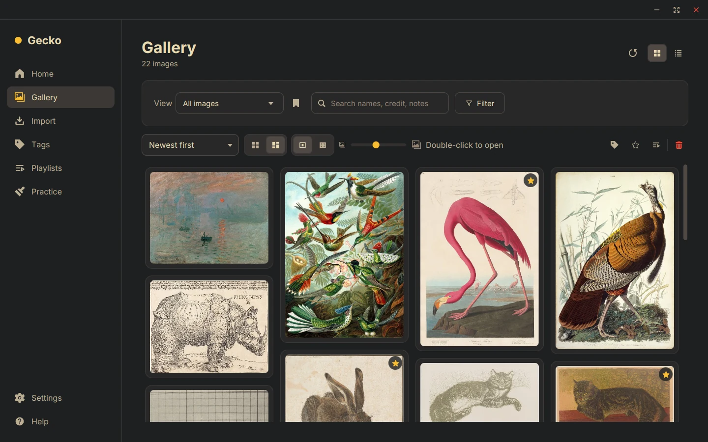
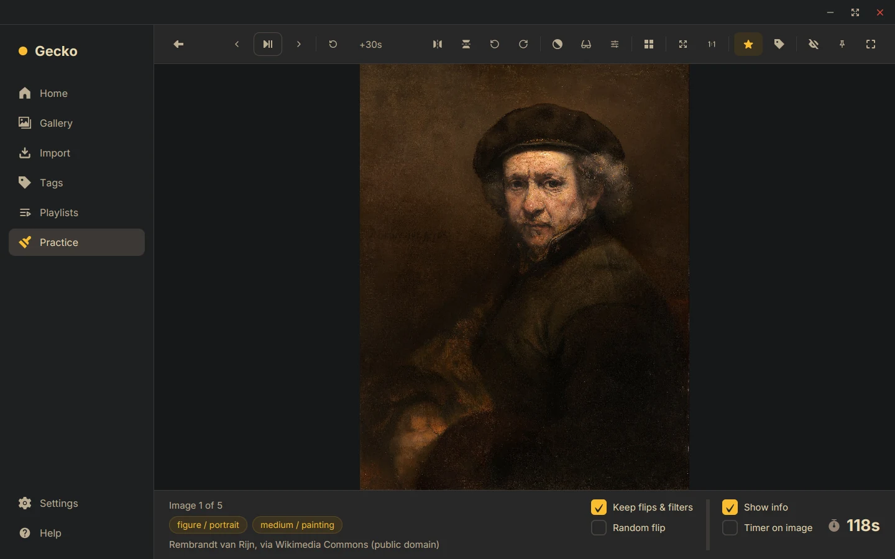
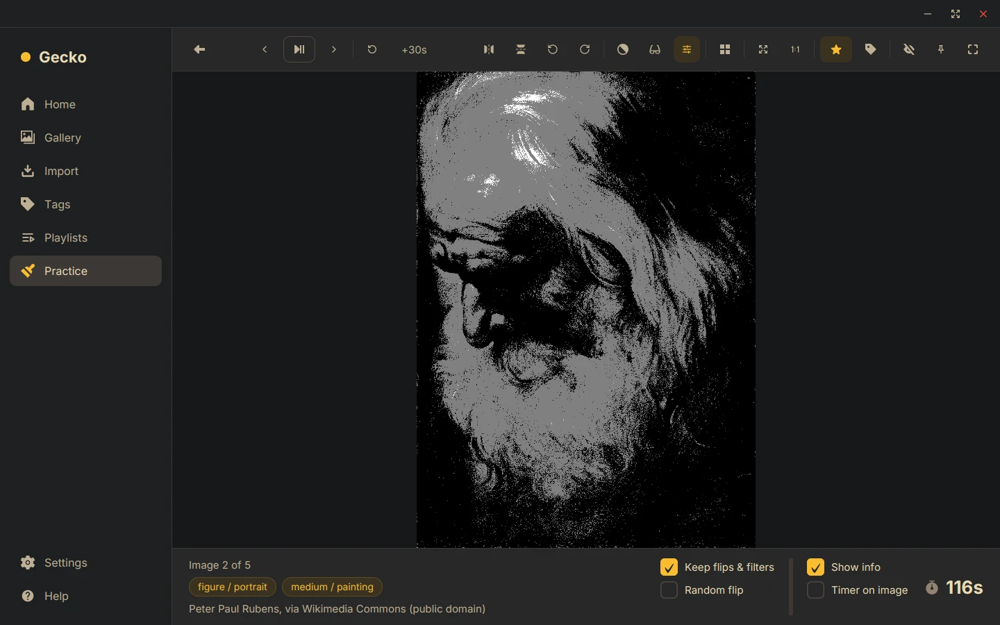
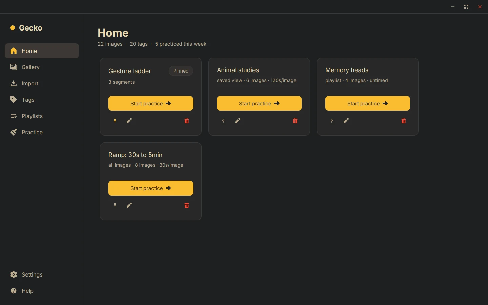
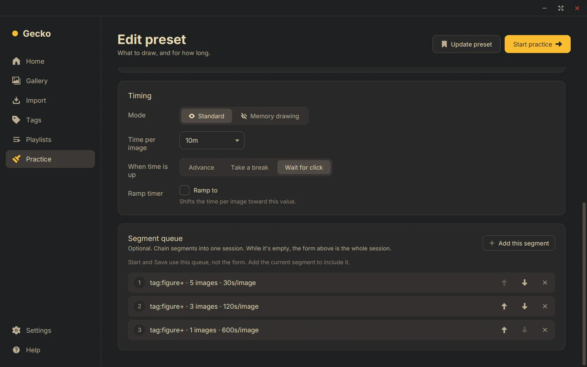
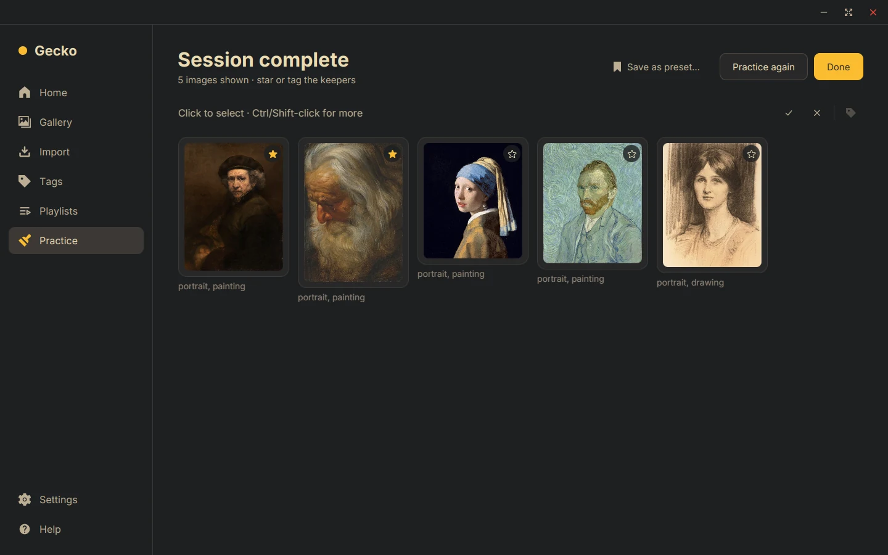
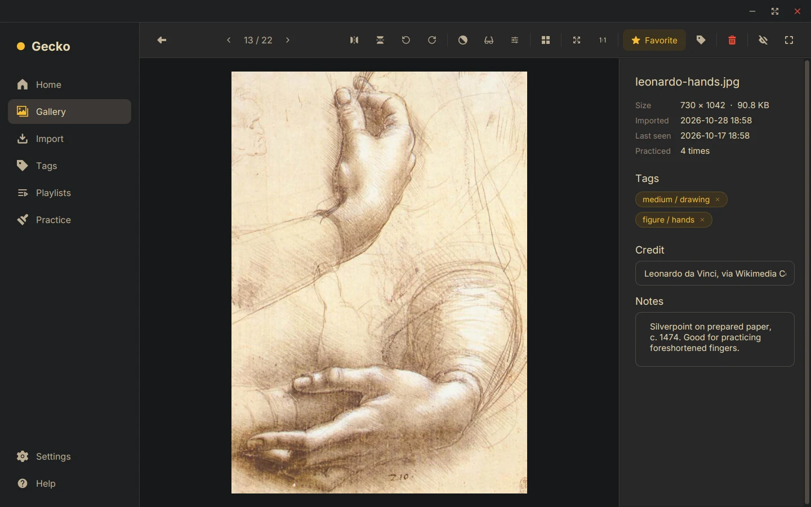
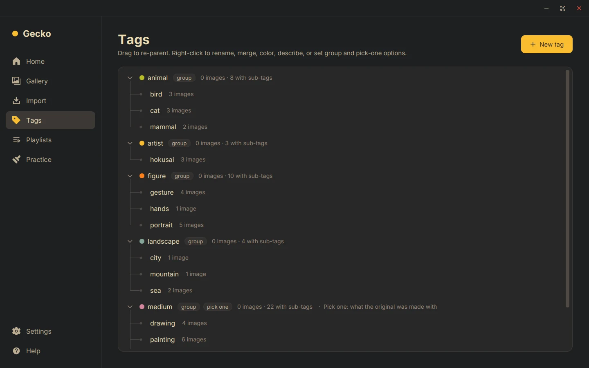
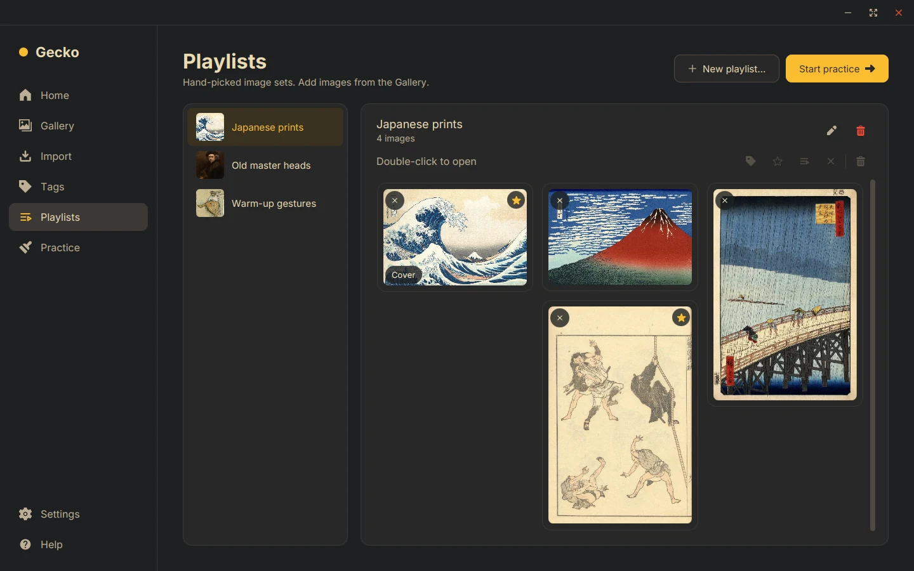
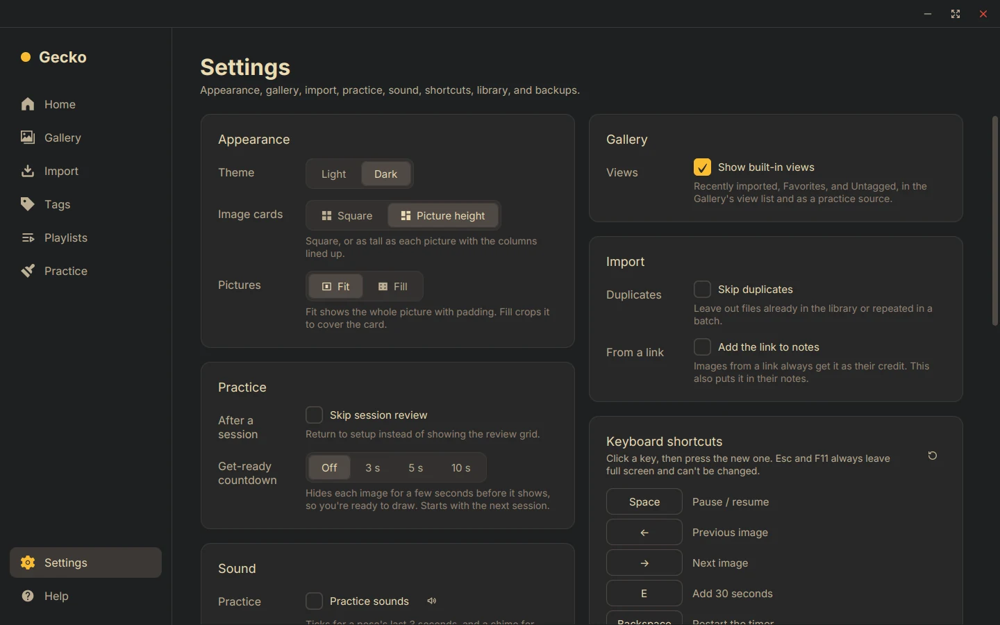

<h1 align="center">Gesturtle</h1>

<p align="center">
  A desktop app for timed drawing practice, built around your own tagged library of reference images.
</p>

<p align="center">
  
  
  
  
  
  
</p>

<picture>
  <source media="(prefers-color-scheme: light)" srcset="docs/screenshots/gallery-light.webp">
  
</picture>

Sites like Line of Action and Quickposes are great until you want to practice from *your* references.
Gesturtle imports your images into a local library, lets you tag and filter them however you like,
and turns any slice of that library into a gesture, memory, or study session in one click.

## Features

**Practice**
- Timed sessions from 30 seconds to untimed, with breaks or click-to-advance between images
- Chain segments into one session, like 5 × 30s, then 3 × 2min, then 1 × 10min
- Ramping timers that grow across a segment, say from 30 seconds to 5 minutes
- Memory drawing: study the image, draw it hidden, then compare
- Study aids that never touch the original: flip, rotate, zoom, grayscale, blur, grid, invert,
  brightness and contrast, and a 2 to 4 tone value study
- While you draw: add 30 seconds, restart the timer, keep the window on top, or hide everything but the image
- A review grid after each session to star or tag the keepers
- Presets on the Home page start a session in one click, and an interrupted session can be resumed

**Library**
- Import by drag and drop (files, folders, or images straight from a browser), paste, or link,
  with duplicates caught by content. PNG, JPEG, GIF, BMP, and WebP
- Hierarchical tags (`animal / bird`) with colors and descriptions, plus group-only and pick-one tags
- Filters with And, Or, and Exclude, saved as reusable views that practice can draw from
- A gallery of square or picture-height (masonry) cards, fitted or cropped to fill, plus a list view, all resizable
- Playlists for hand-picked sets, with bulk tagging, favoriting, copying, and removal
- Favorites, credit and notes per image, seen counts, and a "not seen in N days" filter
- Deleted images go to the system trash, and a library check restores missing files from a folder you pick

**Everything else**
- Light and dark themes (Gruvbox), rebindable shortcuts, and subtle sounds
- Animations and scrolling that run at your display's refresh rate
- The library is one self-contained folder: back it up, sync it, or [keep it in git](#keeping-it-in-git)
- Portable export and import archives for moving between machines

## Screenshots

| | |
|:---:|:---:|
|  |  |
| **Practice** with the timer, tags, and credit | **Value study** in three tones |
|  |  |
| **Home** presets, one click to start | **Session setup** with a three-segment queue |
|  |  |
| **Review** every image after a session | **Image detail** with tags, credit, and notes |
|  |  |
| **Tags** that nest, drag to re-parent | **Playlists** for hand-picked sets |
|  | |
| **Settings** for cards, practice, sound, and shortcuts | |

## Getting started

Requires **JDK 21** and **Maven**.

```bash
git clone https://github.com/hutnerr/gesturtle.git && cd gesturtle
mvn javafx:run
```

The sound effects aren't in the repo (their license doesn't allow redistributing the files), so a build
from source runs silently. To hear them, get the free
["UI SFX Vol.1 - Lite"](https://inaruna3565.itch.io/ui-sfx-vol-1-lite) pack and copy its "Minimal" sounds into
`src/main/resources/sounds/` as `minimal-click.wav`, `minimal-confirm.wav`, `minimal-cancel.wav`,
`minimal-error.wav`, and `minimal-success.wav`.

On first launch, pick (or create) a folder for your library, then:

1. **Import** a few images or a whole folder. Add batch tags as you go.
2. **Tag** them in the Gallery or the Tags page.
3. Hit **Start practice** on a Home preset, or build a session on the Practice page.

### Native app bundle

```bash
./jpackage.sh            # runnable app folder in dist/
./jpackage.sh deb        # or rpm, dmg, pkg, msi, exe for your platform
```

### Tests

```bash
mvn test
```

## Shortcuts

| Key | Action | Key | Action |
|---|---|---|---|
| `Space` | Pause / resume | `G` | Grayscale |
| `←` `→` | Previous / next | `B` | Blur |
| `E` | Add 30 seconds | `L` | Value study (2 → 3 → 4 tones → off) |
| `Backspace` | Restart the timer | `R` | Grid |
| `F` | Favorite | `I` | Invert |
| `T` | Tag | `A` | Brightness and contrast |
| `P` | Keep window on top | `H` `V` | Flip |
| `Z` | Hide controls | `[` `]` | Rotate |
| `Esc` | Exit | `+` `-` `0` `1` | Zoom in, out, fit, 100% |
| `F11` | Full screen | `Ctrl+V` | Paste images to import |

All of them are rebindable in Settings, which lists the rest.

## How it works

Your library is a folder you choose. Images are stored by their SHA-256 hash, so duplicates are caught
for free. Everything you'd want to keep lives in small JSON files under `meta/`, one per image, tag,
playlist, view, and preset. A SQLite database next to them is a local cache, rebuilt from `meta/` when
it's missing, that also holds what belongs to one machine: practice history, seen counts, layout and sort.

```
library/
  meta/             tags, image details, playlists, views, presets (JSON)
  images/ab/cd/     originals, named by content hash
  gesturtle.db      local cache and practice history
  thumbs/           thumbnail cache, rebuilt on demand
  exports/          export archives
```

Every practice mode is the same model underneath: a session is a list of segments, and each segment has
a source (filter, playlist, or view), a count, an order, and a timer.

### Keeping it in git

The library folder can be a git repo, and Gesturtle writes a `.gitignore` and `.gitattributes` for it.
Git tracks `images/` and `meta/`; the database, thumbnails, and exports stay out, so
practicing never leaves anything to commit.

Pull and push whenever you like. Gesturtle reads a pull when you come back to its window. Edits to different
images, tags, or views are edits to different files, so they merge on their own, and a tag made on both
machines becomes one. Changing the same thing on both machines gives an ordinary git conflict: Gesturtle lists
any file it can't read, and picks it up once you fix it.

## Roadmap

- **Import whole boards from reference sites.** Paste a Pinterest board link and pull in every pin, with
  each pin's link as its credit. Other sites artists commonly collect references on are candidates too:
  ArtStation, Are.na, DeviantArt and Behance collections, Flickr albums, Tumblr, and Line of Action or
  Quickposes sets.

## Credits

- Sound effects: ["UI SFX Vol.1 - Lite"](https://inaruna3565.itch.io/ui-sfx-vol-1-lite) by inaruna3565 ("Minimal" theme), royalty-free
- Color palette: [Gruvbox](https://github.com/morhetz/gruvbox) by Pavel Pertsev (morhetz), MIT
- Typeface: [Inter](https://rsms.me/inter/) by Rasmus Andersson, SIL Open Font License
- Icons: [SVG Repo](https://www.svgrepo.com), [Lucide](https://lucide.dev) (ISC), [Material Icons](https://fonts.google.com/icons) by Google (Apache 2.0), and 16pxls by Paul Mackenzie (CC BY-SA 4.0)
- Screenshot artwork: public domain works by Rembrandt, Vermeer, Rubens, Van Gogh, Sargent, Leonardo da Vinci,
  Degas, Dürer, Hokusai, Hiroshige, Monet, Audubon, Haeckel, Muybridge, and Steinlen, via
  [Wikimedia Commons](https://commons.wikimedia.org)

## License

Copyright (C) 2026 Hunter Baker

Gesturtle is free software: you can redistribute it and/or modify it under the terms of the
[GNU General Public License v3.0](LICENSE) as published by the Free Software Foundation, either version 3
of the License, or (at your option) any later version. It is distributed in the hope that it will be useful,
but WITHOUT ANY WARRANTY; without even the implied warranty of MERCHANTABILITY or FITNESS FOR A
PARTICULAR PURPOSE. See the license for details.

The license covers the code. It doesn't cover:

- **The Gesturtle name and logo.** A fork is welcome, but give it its own name and icon so nobody mistakes it
  for this project.
- **Third-party assets** listed under [Credits](#credits), which keep their own licenses. In particular, the
  sound effects may be shipped inside the app but not redistributed as files on their own.
