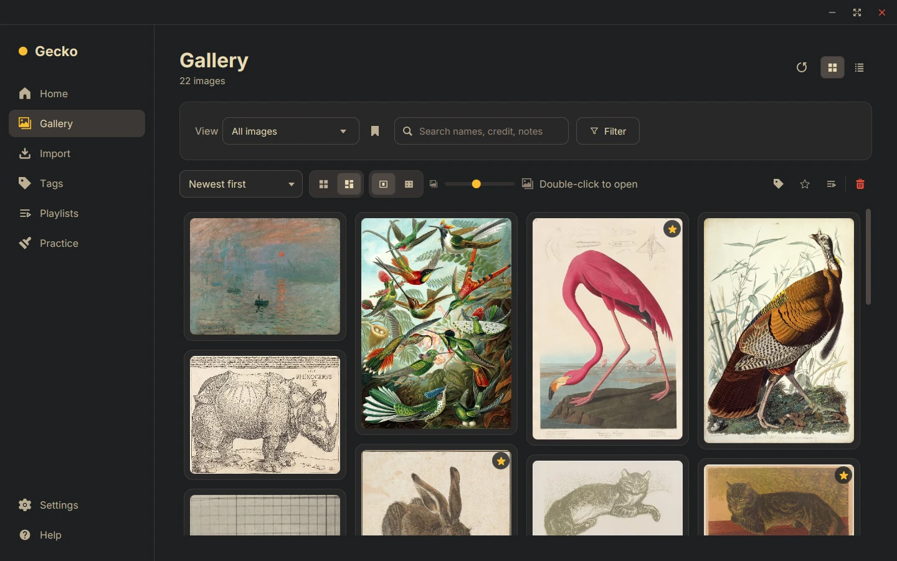
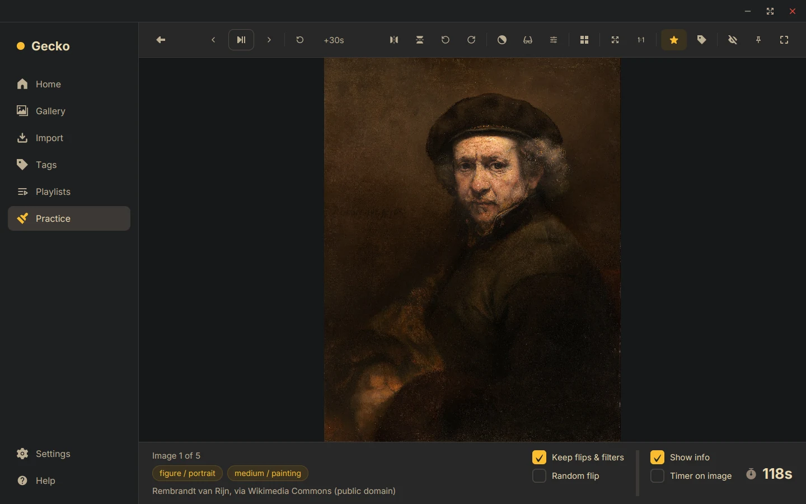
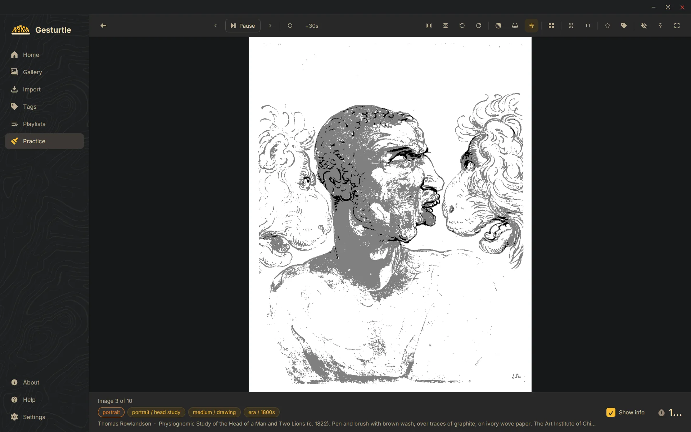
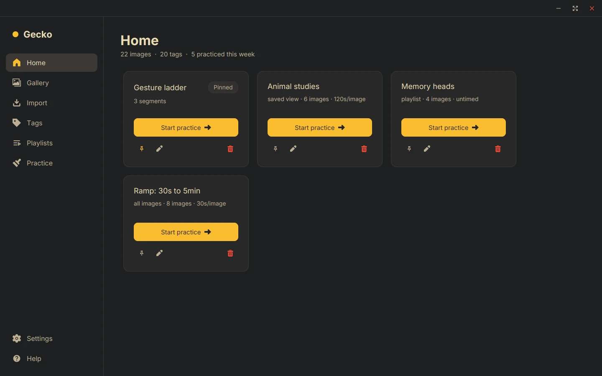
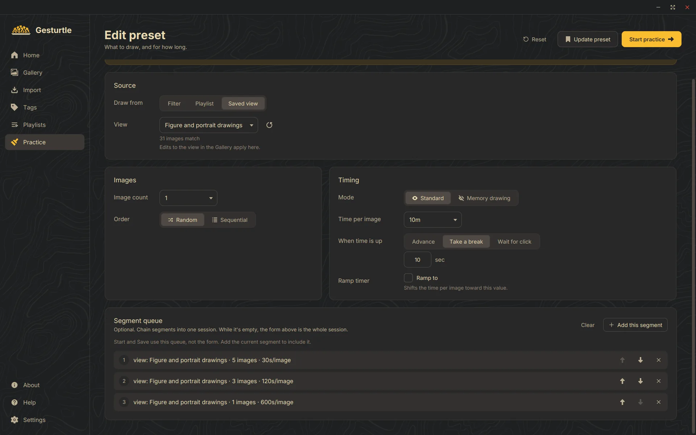
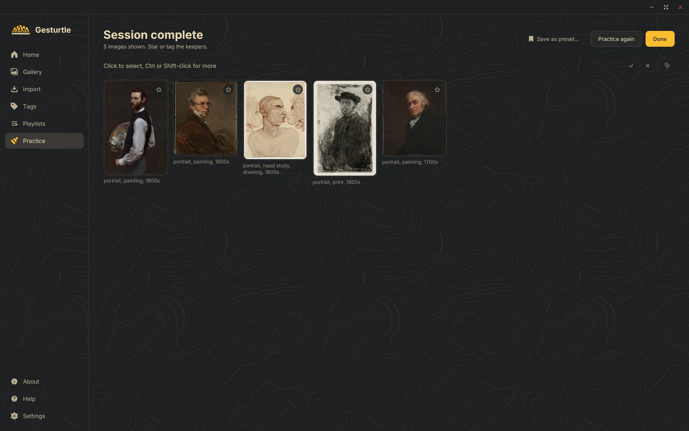
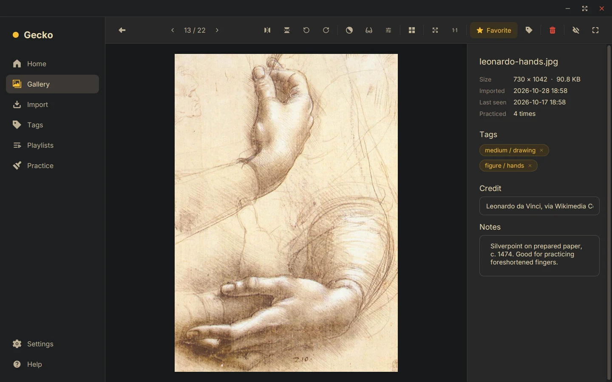
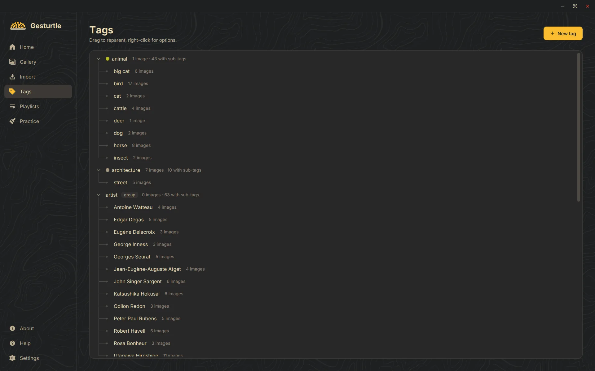
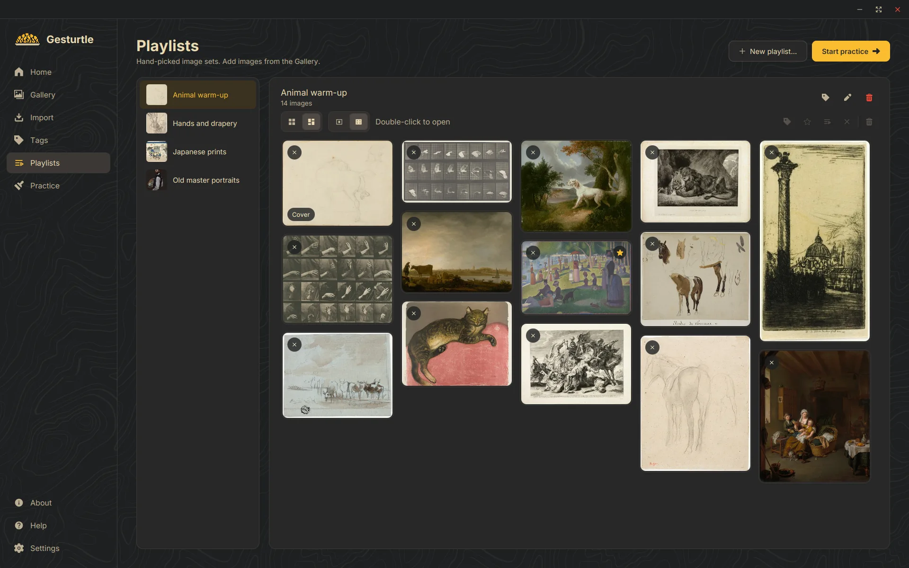

> This project is mostly completed but a roadmap exists and may receive new features.

## Overview
A desktop app for timed drawing practice, built around your own tagged library of reference images. 

Sites like [Line of Action](https://line-of-action.com/practice-tools/app/figure-drawing) and [Quickposes](https://quickposes.com/en) are great until you want to practice from *your* references. Gesturtle imports your images into a local library, lets you tag and filter them however you like, and turns any part of that library into a study session.

**Tech Stack:** Java 21, JavaFX, SQLite

**Roadmap:**
- **Board Imports**: Paste a Pinterest board link and pull in every pin, with each pin's link as its credit. Other reference sites are candidates too

**Links:**
- [Example Library](https://www.hunter-baker.com/assets/projects/gesturtle/gesturtle-example-library.zip)

> View more about the project on its [showcase page](https://www.hunter-baker.com/pages/projects/gesturtle.html).

<picture>
  <source media="(prefers-color-scheme: light)" srcset="docs/screenshots/gallery-light.webp">
  
</picture>

## Features
**Practice**
- **Timed Sessions**: From 30 seconds to untimed, with breaks or click-to-advance between images
- **Segments**: Chain several into one session, like 5 × 30s, then 3 × 2min, then 1 × 10min
- **Ramping Timers**: Times that grow across a segment, say from 30 seconds to 5 minutes
- **Memory Drawing**: Study the image, draw it hidden, then compare
- **Study Aids**: Flip, rotate, zoom, grayscale, blur, grid, invert, brightness and contrast, and a 2 to 4 tone value study, without touching the original
- **Review**: Star or tag the keepers after each session
- **Presets**: Start a session from the Home page in one click, and resume interrupted ones

**Library**
- **Import**: Drag and drop files, folders, or images from a browser, or paste them. Duplicates are caught by content
- **Tags**: Hierarchical (`animal / bird`), with colors, descriptions, and group-only or pick-one tags
- **Filters**: And, Or, and Exclude, saved as reusable views that practice can draw from
- **Gallery**: Square or masonry cards, plus a list view, all resizable
- **Playlists**: Hand-picked sets, with bulk tagging, favoriting, and removal
- **Image Details**: Favorites, credit, notes, seen counts, and a "not seen in N days" filter
- **Portable**: The library is one self-contained folder, so you can back it up, sync it, or [keep it in git](#keeping-it-in-git)

## Usage
On first launch, pick (or create) a folder for your library, then:

1. **Import** a few images or a whole folder and add tags.
2. **View** them in the Gallery.
3. Hit **Start practice** on a Home preset, or build a session on the Practice page.

To try it without your own images, download the [example library](https://www.hunter-baker.com/assets/projects/gesturtle/gesturtle-example-library.zip) and open it through **Settings › Backup › Import archive…**

## Showcase
<table>
  <tr>
    <td></td>
    <td></td>
  </tr>
  <tr>
    <td></td>
    <td></td>
  </tr>
  <tr>
    <td></td>
    <td></td>
  </tr>
  <tr>
    <td></td>
    <td></td>
  </tr>
</table>

## How It Works
Your library is a folder you choose. Images are stored by their SHA-256 hash, so duplicates are caught for free. Everything worth keeping lives in small JSON files under `meta/`, one per image, tag, playlist, view, and preset. The SQLite database is a local cache rebuilt from `meta/`, and also holds machine-specific data like practice history and seen counts.

```
library/
  meta/             tags, image details, playlists, views, presets (JSON)
  images/ab/cd/     originals, named by content hash
  gesturtle.db      local cache and practice history
  thumbs/           thumbnail cache, rebuilt on demand
  exports/          export archives
```

Every practice mode is the same model underneath: a session is a list of segments, and each segment has a source (filter, playlist, or view), a count, an order, and a timer.

### Keeping it in git
The library folder can be a git repo. Gesturtle writes a `.gitignore` that tracks `images/` and `meta/` and leaves out the database, thumbnails, and exports, so practicing never leaves anything to commit.

Pull and push whenever you like. Edits to different images, tags, or views are edits to different files, so they merge on their own. Changing the same thing on two machines gives an ordinary git conflict, and Gesturtle picks the file back up once you fix it.

## Setup
To run this locally, you need **JDK 21** and **Maven**.

```bash
git clone https://github.com/hutnerr/gesturtle.git && cd gesturtle
mvn javafx:run
```

The sound effects aren't in the repo because their license doesn't allow redistributing the files, so a build from source runs silently. To hear them, get the free ["UI SFX Vol.1 - Lite"](https://inaruna3565.itch.io/ui-sfx-vol-1-lite) pack and copy its "Minimal" sounds into `src/main/resources/sounds/` as `minimal-click.wav`, `minimal-confirm.wav`, `minimal-cancel.wav`, `minimal-error.wav`, and `minimal-success.wav`.

To build a native app bundle or run the tests:

```bash
./jpackage.sh            # runnable app folder in dist/
./jpackage.sh deb        # or rpm, dmg, pkg, msi, exe for your platform
mvn test
```

## License & Credits
The project is licensed under the [GNU General Public License v3.0](LICENSE). The license covers the code, but not the Gesturtle name and logo (forks are welcome under their own name and icon) or the third-party assets below, which keep their own licenses.

- **["UI SFX Vol.1 - Lite"](https://inaruna3565.itch.io/ui-sfx-vol-1-lite)** by inaruna3565 - Royalty-free, may be shipped inside the app but not redistributed as files
- **[Gruvbox](https://github.com/morhetz/gruvbox)** by Pavel Pertsev - MIT
- **[Inter](https://rsms.me/inter/)** by Rasmus Andersson - SIL Open Font License
- **Icons** from [SVG Repo](https://www.svgrepo.com), [Lucide](https://lucide.dev) (ISC), [Material Icons](https://fonts.google.com/icons) by Google (Apache 2.0), and 16pxls by Paul Mackenzie (CC BY-SA 4.0)
- **Screenshot artwork and the example library** are public domain works by Degas, Seurat, Sargent, Hokusai, Hiroshige, Audubon, and others, from the open access collections of [The Metropolitan Museum of Art](https://www.metmuseum.org/about-the-met/policies-and-documents/open-access) and [The Art Institute of Chicago](https://www.artic.edu/open-access/open-access-images) (CC0)

## Support
If you found this project helpful or enjoyable, and want to support future work, you can buy me a coffee on Ko-fi
<br><br>
[](https://ko-fi.com/S6S71TM9XT)
